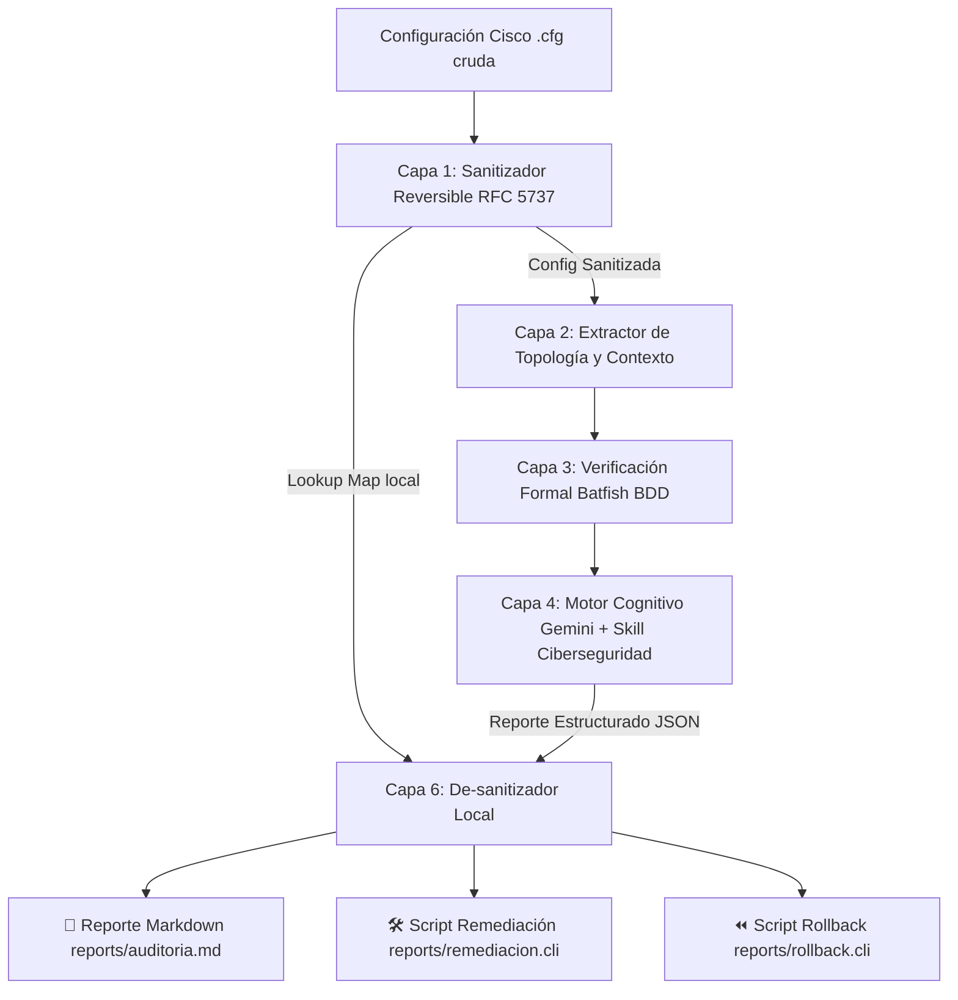

# Cisco AI Firewall Auditor & Change Impact Advisor (`cisco-ai-firewall-auditor`)

[](https://www.python.org/downloads/)
[](https://opensource.org/licenses/MIT)
[](https://ai.google.dev/)
[](https://www.batfish.org/)

Herramienta profesional de CLI en Python diseñada para auditar configuraciones de firewalls y routers Cisco (`Cisco IOS`, `IOS-XE` y `Cisco ASA`), combinando **verificación formal matemática (Batfish)** con **razonamiento semántico de ciberseguridad (Google Gemini con Skill de Auditoría)**.

Su valor no es solo listar fallas, sino actuar como un **Asistente de Gestión de Cambios**, calculando el radio de impacto operativo (*Blast Radius*), ofreciendo alternativas de decisión (**Plan A: Hardening Directo** vs. **Plan B: Transición con Logging**) y generando scripts `.cli` de remediación y *rollback* listos para producción.

---

## 🎯 Problema Exacto que Resuelve

1. **Alucinación aritmética de los LLMs en redes:** Los modelos de lenguaje suelen equivocarse al calcular máscaras *wildcard* inversas (`0.0.15.255`), solapamiento de subredes y jerarquías de reglas. Se resuelve delegando el álgebra booleana exacta a **Batfish**.
2. **Falta de contexto de seguridad en motores matemáticos:** Batfish detecta reglas inalcanzables (*shadowed*), pero desconoce si un `permit tcp any any eq 23` o un `remark Regla temporal 2023` viola las directivas de seguridad corporativas. Se resuelve con **Gemini + Skill de Ciberseguridad (CIS Benchmark, DISA STIG y NIST CSF)**.
3. **Miedo al corte de servicio en producción:** Tocar una ACL activa en un entorno empresarial genera incertidumbre. La herramienta calcula el *Blast Radius* y formula un **Plan B de transición pasiva** (auditar hits con `log` antes de bloquear).
4. **Privacidad y Zero-Leak:** Enmascara automáticamente IPs públicas reales utilizando bloques sintéticos del RFC 5737 (`192.0.2.0/24`, `198.51.100.0/24`, etc.) y ofusca contraseñas/secretos antes de consultar la API externa, restaurando los valores reales localmente en los entregables finales.

---

## 🏗️ Arquitectura del Pipeline



---

## 🚀 Requisitos del Sistema e Instalación

### Requisitos Previos (Xubuntu / Linux):
* Python `>= 3.10`
* Docker Engine & Docker Compose (para Batfish)
* Mínimo 8 GB de RAM

### 1. Clonar el repositorio y configurar entorno
```bash
git clone https://github.com/LabordaSebastian/Auditor_Firewall_IA.git
cd Auditor_Firewall_IA

# Crear entorno virtual
python3 -m venv .venv
source .venv/bin/activate

# Instalar dependencias
pip install -r requirements.txt
```

### 2. Configurar variables de entorno
Copia la plantilla y edita tu archivo `.env`:
```bash
cp .env.example .env
```
Configura tu clave de Gemini:
```env
GEMINI_API_KEY="tu_clave_de_google_ai_studio"
GEMINI_MODEL="gemini-3.8-flash"
BATFISH_HOST="localhost"
BATFISH_PORT=9997
```

### 3. Iniciar el servicio Batfish en Docker
```bash
docker compose up -d
```

---

## 💻 Uso de la Línea de Comandos (CLI)

### Diagnóstico del Entorno
Verifica que las credenciales y el contenedor Batfish estén listos:
```bash
python -m src.cli check-env
```

### Previsualizar Sanitización (Zero-Leak)
Observa qué IPs públicas y secretos se enmascararán antes de enviarse a la nube:
```bash
python -m src.cli sanitize-preview snapshots/lab_cisco_vuln/configs/fw-borde-ios.cfg
```

### Ejecutar Auditoría Completa en CLI
Audita un router o firewall Cisco con el pipeline completo (Batfish formal + Gemini):
```bash
python -m src.cli audit snapshots/lab_cisco_vuln/configs/fw-borde-ios.cfg
```

### Iniciar el Dashboard Web Interactivo (MEJ-05)
Lanza la plataforma web en modo oscuro con estética *Glassmorphism*, grafo topológico vivo y simulador en tiempo real:
```bash
python -m src.cli serve --host 127.0.0.1 --port 8000 --open-browser
```
Accede desde tu navegador a `http://127.0.0.1:8000`:
* **Carga de Configuraciones:** Arrastra archivos `.cfg` o carga demos de un clic para Cisco IOS y ASA.
* **Sanitización Transparente:** Switch Zero-Leak (activo por defecto) con visor de diferencias (Original vs. Sanitizado).
* **Distribución Gráfica de Riesgo:** Gráficos vectoriales Donut SVG de Severidad y Taxonomía con filtrado interactivo.
* **Grafo Topológico con Física Elástica:** Explora interfaces y zonas de seguridad arrastrando nodos con física reactiva a 60 FPS.
* **Simulador "El Camino del Paquete":** Ejecuta `bf.q.traceroute()` en vivo y observa la animación del paquete con identificación de reglas de bloqueo.
* **Matriz de Aislamiento y Perímetros:** Evaluación visual de segmentación Zero Trust entre zonas.
* **Digital Twin Diferencial (`compareFilters`):** Compara el impacto del Plan A o Plan B antes de tocar producción.
* **Exportación en un Clic:** Descarga informes en **PDF corporativo**, Markdown o scripts `.cli` de remediación/rollback.


---

## 📦 Entregables Generados en `reports/`

Por cada auditoría ejecutada, el sistema genera automáticamente:
1. `reports/auditoria_<nombre>.md`: Informe técnico y ejecutivo con postura de seguridad (0 a 100), matriz de severidad, fichas detalladas de hallazgos y análisis de *Blast Radius*.
2. `reports/remediacion_<nombre>.cli`: Script de configuración en sintaxis nativa de Cisco CLI listo para aplicar en ventana de mantenimiento.
3. `reports/rollback_<nombre>.cli`: Script de marcha atrás para revertir los cambios en segundos si ocurre una contingencia.
4. `reports/auditoria_<nombre>.json`: Estructura de datos completa para integración con SIEM o pipelines DevNet/CI-CD.

---

## 🧪 Pruebas Automatizadas

Ejecutar la suite completa de pruebas unitarias:
```bash
pytest tests/
```
