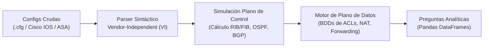

# 🦇 Manual Práctico y Referencia Formal de Batfish
## Guía de Aprendizaje Interactivo, Análisis Matemático y Auditoría de Redes

---

## 📌 1. Introducción y Fundamentos de Batfish

**Batfish** es un motor de análisis estático y verificación formal para configuraciones de red (Cisco IOS, Cisco IOS-XE, Cisco ASA, Arista, Juniper, etc.).

A diferencia de emuladores o simuladores de red tradicionales:

| Característica | Emuladores (EVE-NG, GNS3, CML) | Batfish (Verificación Formal) |
| :--- | :--- | :--- |
| **Naturaleza** | Ejecutan imágenes de software real en VMs. | Analizador estático de texto plano (`running-config`). |
| **Consumo de recursos** | Gigabytes de RAM y CPU por cada nodo encendido. | Contenedor ligero; analiza redes enteras en segundos. |
| **Pruebas de tráfico** | Requiere generar tráfico real (pings, iperf). | Evaluación matemática exhaustiva con **Diagramas de Decisión Binaria (BDD)**. |
| **Falsos positivos** | N/A (depende del estado transitorio). | **0% de falsos positivos**: demostración matemática formal. |
| **Análisis de cambio** | Prueba y error en laboratorio. | **Análisis diferencial nativo** (comparación antes vs. después). |

### El Pipeline Interno de Batfish



---

## 📊 2. Tabla Maestra de Funcionalidades y Consultas (Cheat Sheet)

Esta tabla resume las principales capacidades analíticas disponibles en la API de Batfish (`bf.q.<consulta>`):

| Categoría | Consulta Pybatfish | Propósito y Valor en Seguridad |
| :--- | :--- | :--- |
| **Higiene & Parsing** | `bf.q.initIssues()` | Detecta líneas no reconocidas o errores de sintaxis en las configuraciones cargadas. |
| **Inventario & Topología** | `bf.q.nodeProperties()` | Obtiene hostnames, versiones de SO, servidores NTP, DNS y configuración global. |
| **Inventario & Topología** | `bf.q.interfaceProperties()` | Mapea interfaces, MTU, VRFs, zonas de seguridad, switchports y estado operativo. |
| **Inventario & Topología** | `bf.q.ipOwners()` | Mapea todas las IPs y máscaras asignadas a interfaces en toda la red. |
| **Topología & Enlaces L3** | `bf.q.layer3Edges()` | **Deduce adyacencias:** Determina qué interfaces están conectadas cara a cara a nivel de Capa 3 sin requerir diagramas externos. |
| **Topología Dinámica** | `bf.q.ospfEdges()` / `bf.q.bgpEdges()` | Mapea adyacencias OSPF y sesiones BGP activas calculadas por el plano de control. |
| **Auditoría de ACLs** | `bf.q.filterLineReachability()` | **Crítico:** Identifica líneas de ACL inalcanzables (*shadowed*) o completamente redundantes. |
| **Auditoría de ACLs** | `bf.q.testFilters()` | Evalúa un paquete hipotético (`HeaderConstraints`) contra una ACL aislada. |
| **Plano de Control** | `bf.q.routes()` | Calcula la tabla de enrutamiento convergida (FIB/RIB) con distancias administrativas y métricas. |
| **Plano de Control** | `bf.q.bgpRib()` / `bf.q.ospfRib()` | Inspecciona rutas anunciadas y recibidas por protocolos de enrutamiento dinámico. |
| **Plano de Datos** | `bf.q.traceroute()` | Simula el recorrido salto a salto de un paquete evaluando rutas y filtros en cada interfaz. |
| **Plano de Datos** | `bf.q.reachability()` | **Simbólico:** Encuentra todos los flujos posibles que satisfacen condiciones de origen y destino. |
| **Gestión de Cambios** | `bf.q.differentialReachability()` | **Blast Radius:** Compara dos snapshots (base vs. candidato) y lista los flujos cuyo comportamiento cambió. |

---

## 🛠️ 3. Laboratorio Práctico Paso a Paso (Hands-On Lab)

Esta guía reproduce paso a paso el laboratorio de auditoría ejecutado contra el contenedor Docker de Batfish.

### Requisitos Previos

1. Contenedor Batfish en ejecución:
   ```bash
   docker run -d --name batfish-allinone -p 9996:9996 -p 9997:9997 batfish/allinone:latest
   ```
2. Entorno virtual activo con `pybatfish` y `pandas`:
   ```bash
   python3 -m venv .venv
   source .venv/bin/activate
   pip install pybatfish pandas
   ```
3. Iniciar consola interactiva de Python:
   ```bash
   .venv/bin/python
   ```

---

### Módulo 1: Conexión Inicial e Inspección de Interfaces

Configuramos una sesión con el contenedor y cargamos un router Cisco IOS básico:

```python
import os
import tempfile
import pandas as pd
from pybatfish.client.session import Session
from pybatfish.datamodel import HeaderConstraints, PathConstraints

# 1. Conexión al servicio
bf = Session(host="localhost")
bf.set_network("laboratorio_aprendizaje")

# 2. Configuración Cisco IOS base
cfg_core = """!
hostname Router-Core
!
interface GigabitEthernet0/0
 ip address 10.0.1.1 255.255.255.0
 no shutdown
!
interface GigabitEthernet0/1
 ip address 172.16.0.1 255.255.255.0
 no shutdown
!
ip route 0.0.0.0 0.0.0.0 172.16.0.2
!
end
"""

# 3. Empaquetar y enviar Snapshot
tmp_dir = tempfile.mkdtemp()
configs_dir = os.path.join(tmp_dir, "configs")
os.makedirs(configs_dir)

with open(os.path.join(configs_dir, "Router-Core.cfg"), "w") as f:
    f.write(cfg_core)

bf.init_snapshot(tmp_dir, name="snapshot_inicial", overwrite=True)

# 4. Validar calidad del parseo
errores = bf.q.initIssues().answer().frame()
print("Errores de parseo:", len(errores))  # Esperado: 0

# 5. Consultar interfaces reconocidas
interfaces = bf.q.interfaceProperties().answer().frame()
print(interfaces[['Interface', 'Active', 'Admin_Up', 'VRF']])
```

---

### Módulo 2: Detección Matemática de Reglas Sombra (*Shadowed ACLs*)

Demostración de cómo Batfish identifica reglas inútiles mediante BDDs:

```python
cfg_acl_rota = """!
hostname FW-Borde
!
ip access-list extended ACL_INSPECCION
 permit ip 10.0.0.0 0.255.255.255 any
 permit tcp 10.1.1.0 0.0.0.255 host 192.168.1.100 eq 80
 permit udp host 10.1.1.5 host 192.168.1.200 eq 53
 deny ip any any
!
end
"""

tmp_dir_2 = tempfile.mkdtemp()
configs_dir_2 = os.path.join(tmp_dir_2, "configs")
os.makedirs(configs_dir_2)

with open(os.path.join(configs_dir_2, "FW-Borde.cfg"), "w") as f:
    f.write(cfg_acl_rota)

bf.init_snapshot(tmp_dir_2, name="snapshot_acl_rota", overwrite=True)

# Consultar líneas inalcanzables
shadow_rules = bf.q.filterLineReachability().answer().frame()
print(shadow_rules[['Unreachable_Line', 'Blocking_Lines', 'Reason']])
```

**Resultado obtenido:**
* Batfish detecta que las reglas específicas de los puertos 80 y 53 son inalcanzables (`BLOCKING_LINES`) debido a la regla más amplia `permit ip 10.0.0.0 0.255.255.255 any`.

---

### Módulo 3: Prueba de Paquetes Sintéticos contra Filtros (`testFilters`)

Evaluación determinística de tráfico individual contra una ACL:

```python
# Caso A: Tráfico interno (10.1.1.5 -> 192.168.1.100:80)
paquete_interno = HeaderConstraints(
    srcIps="10.1.1.5",
    dstIps="192.168.1.100",
    ipProtocols=["tcp"],
    dstPorts="80"
)
resp_a = bf.q.testFilters(filters="ACL_INSPECCION", headers=paquete_interno).answer().frame()
print("Caso A (Interno):")
print(resp_a[['Filter_Name', 'Action', 'Line_Content']])

# Caso B: Tráfico externo no autorizado (200.50.10.20 -> 192.168.1.100:80)
paquete_externo = HeaderConstraints(
    srcIps="200.50.10.20",
    dstIps="192.168.1.100",
    ipProtocols=["tcp"],
    dstPorts="80"
)
resp_b = bf.q.testFilters(filters="ACL_INSPECCION", headers=paquete_externo).answer().frame()
print("\nCaso B (Externo):")
print(resp_b[['Filter_Name', 'Action', 'Line_Content']])
```

---

### Módulo 4: Topología Multidispositivo y Plano de Control (`routes`)

Construcción de un enlace punto a punto (`172.16.1.0/30`) entre una Sucursal y un Firewall Central:

```python
cfg_sucursal = """!
hostname Router-Sucursal
!
interface GigabitEthernet0/0
 description LAN Sucursal
 ip address 192.168.10.1 255.255.255.0
 no shutdown
!
interface GigabitEthernet0/1
 description WAN hacia FW-Central
 ip address 172.16.1.1 255.255.255.252
 no shutdown
!
ip route 10.10.10.0 255.255.255.0 172.16.1.2
!
end
"""

cfg_central = """!
hostname FW-Central
!
interface GigabitEthernet0/0
 description WAN hacia Router-Sucursal
 ip address 172.16.1.2 255.255.255.252
 no shutdown
!
interface GigabitEthernet0/1
 description LAN Servidores
 ip address 10.10.10.1 255.255.255.0
 no shutdown
!
ip route 192.168.10.0 255.255.255.0 172.16.1.1
!
end
"""

tmp_topo = tempfile.mkdtemp()
configs_topo = os.path.join(tmp_topo, "configs")
os.makedirs(configs_topo)

with open(os.path.join(configs_topo, "Router-Sucursal.cfg"), "w") as f:
    f.write(cfg_sucursal)
with open(os.path.join(configs_topo, "FW-Central.cfg"), "w") as f:
    f.write(cfg_central)

bf.init_snapshot(tmp_topo, name="snapshot_topologia", overwrite=True)

# Inspeccionar tabla FIB calculada
rutas = bf.q.routes().answer().frame()
print(rutas[['Node', 'VRF', 'Network', 'Next_Hop', 'Protocol', 'Admin_Distance']])
```

**Análisis de Enrutamiento:**
* Rutas `connected` (AD 0): Subredes locales adjuntas a interfaces físicas.
* Rutas `local` (AD 0, `/32`): IPs propias de los equipos para terminación local.
* Rutas `static` (AD 1): Saltos cruzados resueltos hacia las IPs de interconexión.

---

### Módulo 5: Traceroute Formal Multisalro

Rastreo formal del tráfico atravesando routers y firewalls:

```python
# Flujo: PC Sucursal (192.168.10.50) -> Servidor Central (10.10.10.80:80)
paquete_web = HeaderConstraints(
    srcIps="192.168.10.50",
    dstIps="10.10.10.80",
    ipProtocols=["tcp"],
    dstPorts="80"
)

resultado_trace = bf.q.traceroute(
    startLocation="router-sucursal[GigabitEthernet0/0]",
    headers=paquete_web
).answer().frame()

trace = resultado_trace['Traces'].iloc[0][0]
print("Disposición final:", trace.disposition)  # DELIVERED_TO_SUBNET

for i, hop in enumerate(trace.hops, start=1):
    print(f"Salto {i}: [{hop.node}]")
    for step in hop.steps:
        print(f"   -> {step.action:<12} | {step.detail}")
```

**Disposiciones estándar de Batfish:**
* `ACCEPTED`: El paquete llegó y fue consumido por la IP de gestión/local del equipo destino.
* `DELIVERED_TO_SUBNET`: El paquete llegó a la subred final y se entregó al segmento LAN.
* `DENIED_IN` / `DENIED_OUT`: Bloqueado por una lista de control de acceso de entrada o salida.
* `NO_ROUTE`: No existe ruta en la FIB para reenviar el paquete.
* `LOOP`: Bucle de enrutamiento infinito detectado.

---

### Módulo 6: Reachability Simbólico

Búsqueda global de cualquier vector de tráfico que cumpla condiciones específicas sin necesidad de iterar paquete por paquete:

```python
# Pregunta formal: ¿Puede la sucursal alcanzar el puerto SSH (22) en la red de servidores?
camino = PathConstraints(startLocation="router-sucursal[GigabitEthernet0/0]")
consulta_ssh = HeaderConstraints(
    dstIps="10.10.10.0/24",
    ipProtocols=["tcp"],
    dstPorts="22"
)

flujos_ssh = bf.q.reachability(
    pathConstraints=camino,
    headers=consulta_ssh,
    actions="SUCCESS"
).answer().frame()

print(f"Total de flujos SSH permitidos: {len(flujos_ssh)}")
flujo = flujos_ssh['Flow'].iloc[0]
print(f"Vector encontrado: {flujo.srcIp}:{flujo.srcPort} -> {flujo.dstIp}:{flujo.dstPort}")
```

---

### Módulo 7: Bloqueo de Tráfico y Verificación de Reglas Inbound

Aplicación de una ACL en el firewall para restringir el acceso SSH y verificación del descarte en frontera:

```python
cfg_central_bloqueado = """!
hostname FW-Central
!
ip access-list extended FILTRO_WAN
 deny tcp any any eq 22
 permit ip any any
!
interface GigabitEthernet0/0
 description WAN hacia Router-Sucursal
 ip address 172.16.1.2 255.255.255.252
 ip access-group FILTRO_WAN in
 no shutdown
!
interface GigabitEthernet0/1
 description LAN Servidores
 ip address 10.10.10.1 255.255.255.0
 no shutdown
!
ip route 192.168.10.0 255.255.255.0 172.16.1.1
!
end
"""

tmp_bloqueado = tempfile.mkdtemp()
configs_b = os.path.join(tmp_bloqueado, "configs")
os.makedirs(configs_b)

with open(os.path.join(configs_b, "Router-Sucursal.cfg"), "w") as f:
    f.write(cfg_sucursal)
with open(os.path.join(configs_b, "FW-Central.cfg"), "w") as f:
    f.write(cfg_central_bloqueado)

bf.init_snapshot(tmp_bloqueado, name="snapshot_con_bloqueo", overwrite=True)

# Verificar traceroute bloqueado
trace_bloqueado = bf.q.traceroute(
    startLocation="router-sucursal[GigabitEthernet0/0]",
    headers=consulta_ssh
).answer().frame()

t = trace_bloqueado['Traces'].iloc[0][0]
print("Disposición final:", t.disposition)  # DENIED_IN
print("Último salto:", t.hops[-1].node)
print("Acción de descarte:", t.hops[-1].steps[-1].action, "|", t.hops[-1].steps[-1].detail)
```

---

### Módulo 8: Análisis Diferencial de Seguridad (Antes vs. Después)

Determinación del radio de impacto (*Blast Radius*) antes de tocar equipos en producción:

```python
# 1. Comparar comportamiento de SSH entre ambos snapshots
diff_ssh = bf.q.differentialReachability(
    pathConstraints=camino,
    headers=consulta_ssh
).answer(
    snapshot="snapshot_con_bloqueo",
    reference_snapshot="snapshot_topologia"
).frame()

print(f"Flujos SSH con cambio de comportamiento: {len(diff_ssh)}")
print("  * Antes del cambio:  ", diff_ssh['Reference_Traces'].iloc[0][0].disposition)
print("  * Después del cambio:", diff_ssh['Snapshot_Traces'].iloc[0][0].disposition)

# 2. Comprobar que el tráfico web (puerto 80) NO sufrió impacto colateral
consulta_web = HeaderConstraints(dstIps="10.10.10.0/24", ipProtocols=["tcp"], dstPorts="80")
diff_web = bf.q.differentialReachability(
    pathConstraints=camino,
    headers=consulta_web
).answer(
    snapshot="snapshot_con_bloqueo",
    reference_snapshot="snapshot_topologia"
).frame()

print(f"Flujos Web (puerto 80) afectados: {len(diff_web)}")  # Esperado: 0
```

---

### Módulo 9: Soporte de Objetos y Grupos de Red de Cisco ASA

Batfish traduce directamente las construcciones complejas de objetos a espacios booleanos:

```python
cfg_asa_objetos = """!
hostname ASA-Core
!
object-group network IPS_DE_SERVIDORES
 network-object host 10.10.10.50
 network-object host 10.10.10.60
 network-object 10.10.20.0 255.255.255.0
!
access-list ACL_DMZ extended permit tcp any object-group IPS_DE_SERVIDORES eq 443
access-list ACL_DMZ extended deny ip any any
!
end
"""

tmp_obj = tempfile.mkdtemp()
configs_obj = os.path.join(tmp_obj, "configs")
os.makedirs(configs_obj)

with open(os.path.join(configs_obj, "ASA-Core.cfg"), "w") as f:
    f.write(cfg_asa_objetos)

bf.init_snapshot(tmp_obj, name="snapshot_objetos", overwrite=True)

# Prueba con IP incluida en el object-group
p_in = HeaderConstraints(dstIps="10.10.10.50", ipProtocols=["tcp"], dstPorts="443")
ans_in = bf.q.testFilters(filters="ACL_DMZ", headers=p_in).answer().frame()
print("10.10.10.50 ->", ans_in['Action'].iloc[0])  # PERMIT

# Prueba con IP excluida
p_out = HeaderConstraints(dstIps="10.10.10.51", ipProtocols=["tcp"], dstPorts="443")
ans_out = bf.q.testFilters(filters="ACL_DMZ", headers=p_out).answer().frame()
print("10.10.10.51 ->", ans_out['Action'].iloc[0])  # DENY
```

---

## 💡 4. Buenas Prácticas y Troubleshooting en Python / Pandas

1. **Evitar el truncado con puntos suspensivos (`...`):**
   ```python
   import pandas as pd
   pd.set_option('display.max_colwidth', None)
   pd.set_option('display.width', 1000)
   ```
2. **Inspeccionar objetos `Flow`:**
   Los flujos devueltos por Batfish tienen atributos directos:
   ```python
   flujo.srcIp, flujo.dstIp, flujo.srcPort, flujo.dstPort, flujo.ipProtocol
   ```
3. **Valores válidos para el parámetro `actions` en `reachability`:**
   * Usar `"SUCCESS"` para flujos que alcanzan destino (`ACCEPTED`, `DELIVERED_TO_SUBNET`).
   * Usar `"FAILURE"` para flujos bloqueados o sin ruta.
   * O especificar disposiciones concretas en minúsculas: `"denied_in"`, `"denied_out"`, `"no_route"`.

---

## 🗺️ 5. Topologías Lógicas vs. Mapas Interactivos: ¿Batfish genera diagramas de red?

Una duda recurrente en equipos de ingeniería es si Batfish genera directamente diagramas gráficos o mapas interactivos de la red:

### La Conclusión Arquitectónica:
* **Batfish NO genera diagramas visuales, canvas ni gráficos interactivos.** Es un motor *headless* puramente analítico y matemático.
* **Lo que Batfish SÍ hace:** Calcula y descubre la **Teoría de Grafos formal de la red** mediante consultas de aristas (*Edges*):
  * `bf.q.layer3Edges()`: Deduce qué interfaces están conectadas entre sí analizando subredes compartidas (ej. `/30` o `/24`) sin necesidad de diagramas previos.
  * `bf.q.bgpEdges()` / `bf.q.ospfEdges()`: Descubre sesiones de enrutamiento dinámico establecidas entre vecinos.

### Cómo se construye el Mapa Interactivo en la Aplicación Web:
El mapa topológico interactivo con física elástica de nuestra plataforma es una **solución arquitectónica en capas**:
1. **Capa Matemática / Backend (Batfish + Extractor):** Provee la lista estructurada de nodos, interfaces, subredes, zonas de confianza y aristas (`edges`).
2. **Capa de Renderizado Frontend (Canvas / D3 / HTML5):** Toma esa estructura de datos y le aplica fuerzas de repulsión y resortes (física elástica a 60 FPS) para que el operador pueda arrastrar nodos, ver enlaces y simular visualmente el camino del paquete.

### Ejemplo de Consulta de Topología L3 en Batfish:
```python
# Descubrimiento automático de adyacencias de Capa 3
enlaces_l3 = bf.q.layer3Edges().answer().frame()

for _, fila in enlaces_l3.iterrows():
    print(f"[{fila['Interface']}] <==== Enlace L3 ====> [{fila['Remote_Interface']}]")
```
